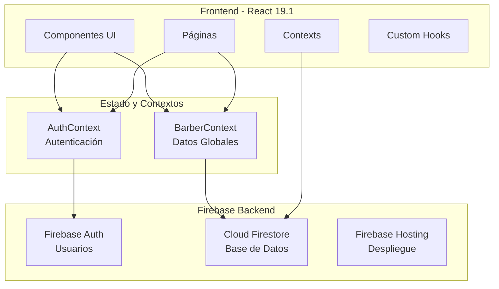
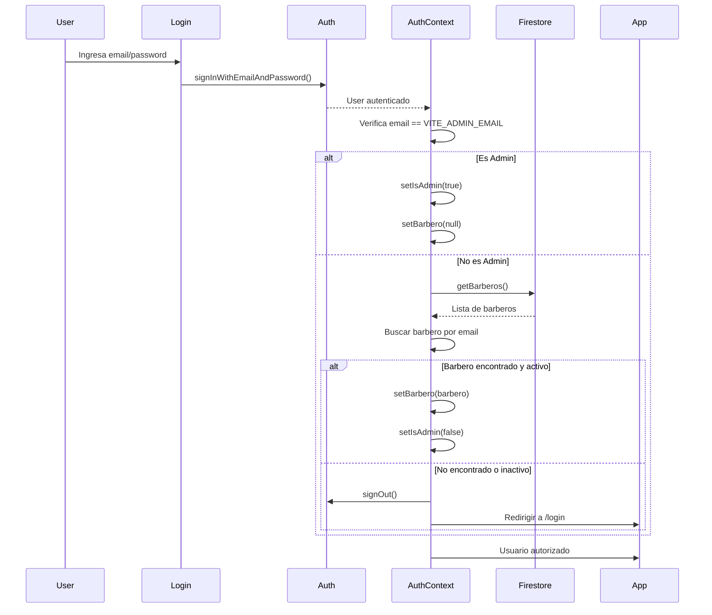
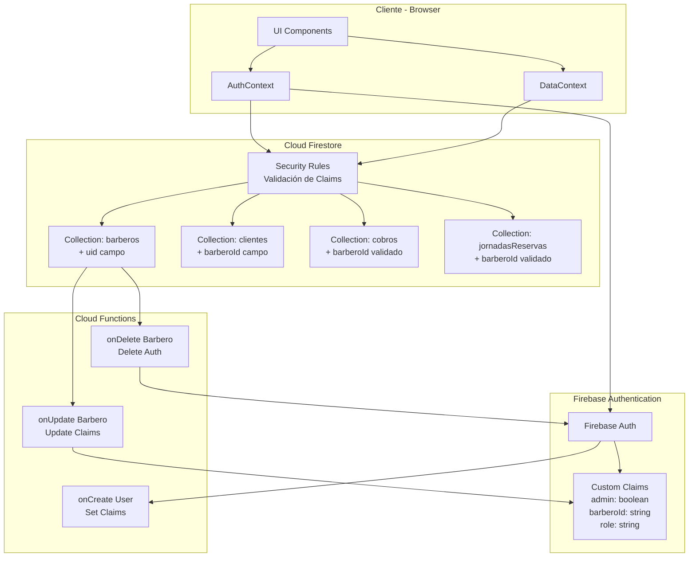

# AUDITORÍA TÉCNICA INTEGRAL — SISTEMA MULTI-BARBERO Y CONTROL DE PERMISOS
## Proyecto: Timontti Barber

**Fecha de Auditoría:** 3 de Noviembre de 2026  
**Versión del Sistema:** 1.0.0  
**Auditor:** Arquitecto de Software Senior

---

## TABLA DE CONTENIDO

1. [Resumen Ejecutivo](#1-resumen-ejecutivo)
2. [Arquitectura Actual Identificada](#2-arquitectura-actual-identificada)
3. [Estado del Sistema Multi-Barbero](#3-estado-del-sistema-multi-barbero)
4. [Auditoría de Autenticación](#4-auditoría-de-autenticación)
5. [Auditoría del Sistema de Permisos](#5-auditoría-del-sistema-de-permisos)
6. [Auditoría de Firestore y Seguridad](#6-auditoría-de-firestore-y-seguridad)
7. [Auditoría de Agendas Independientes](#7-auditoría-de-agendas-independientes)
8. [Problemas y Errores Críticos Encontrados](#8-problemas-y-errores-críticos-encontrados)
9. [Matriz de Funcionalidades](#9-matriz-de-funcionalidades)
10. [Modelo de Permisos Recomendado](#10-modelo-de-permisos-recomendado)
11. [Arquitectura Propuesta](#11-arquitectura-propuesta)
12. [Plan de Implementación por Fases](#12-plan-de-implementación-por-fases)
13. [Riesgos de No Corregir los Problemas](#13-riesgos-de-no-corregir-los-problemas)
14. [Conclusión y Recomendaciones](#14-conclusión-y-recomendaciones)

---

## 1. RESUMEN EJECUTIVO

### 1.1. Estado General del Sistema

El sistema **Timontti Barber** es una aplicación PWA desarrollada en React 19.1 + TypeScript + Firebase, diseñada para gestionar reservas, clientes, planes de membresía y cobros en una barbería. El análisis revela que **el sistema multi-barbero está parcialmente implementado**, con funcionalidades básicas operativas pero con **deficiencias críticas en seguridad, autorización y aislamiento de datos**.

### 1.2. Hallazgos Principales

#### ✅ **FUNCIONANDO CORRECTAMENTE:**
- Creación y registro de barberos en Firestore
- Almacenamiento de permisos individuales por barbero
- Creación de cuentas Firebase Auth mediante `secondaryAuth`
- Asociación de barberos con agendas independientes
- Sistema de reservas públicas con identificación de barbero
- Interfaz de administración de barberos

#### ⚠️ **IMPLEMENTADO PARCIALMENTE:**
- Control de permisos a nivel de UI (oculta elementos visuales)
- Identificación del administrador mediante variable de entorno
- Filtrado de navegación según permisos
- Separación conceptual entre admin y barberos

#### ❌ **DEFICIENTE O FALTANTE:**
- **Seguridad en Firestore:** Reglas permisivas sin validación de roles
- **Variables de entorno:** Email de admin no configurado en .env
- **Autorización real:** Permisos no se validan en operaciones críticas
- **Aislamiento de datos:** Barberos pueden acceder a información de otros
- **Validación backend:** Todas las restricciones son client-side
- **Auditoría:** Sin logs de acceso o cambios por usuario

### 1.3. Nivel de Riesgo Global

**🔴 CRÍTICO** - El sistema presenta vulnerabilidades de seguridad graves que permiten:
- Acceso no autorizado a datos sensibles
- Modificación de permisos propios
- Visualización de información de otros barberos
- Operaciones sin validación de autorización

---

## 2. ARQUITECTURA ACTUAL IDENTIFICADA

### 2.1. Stack Tecnológico



### 2.2. Colecciones de Firestore

| Colección | Propósito | Seguridad Actual |
|-----------|-----------|------------------|
| `clientes` | Información de clientes | ⚠️ Solo admin |
| `planes` | Planes de membresía | ⚠️ Solo admin |
| `cobros` | Registro de pagos | ⚠️ Read/Create público, Update/Delete autenticado |
| `jornadasReservas` | Turnos y agendas | ❌ Lectura/escritura pública total |
| `opcionesCliente` | Servicios configurables | ⚠️ Read público, Write admin |
| `barberos` | Datos de barberos | ⚠️ Read público, Write admin |
| `planTipos` | Tipos de planes | ⚠️ Solo admin |

### 2.3. Flujo de Autenticación Actual



---

## 3. ESTADO DEL SISTEMA MULTI-BARBERO

### 3.1. Creación de Barberos

#### **ARCHIVO:** `src/pages/Barberos.tsx`

**✅ FUNCIONA:**
- Formulario completo de creación con validaciones
- Campos: nombre, email, password, whatsapp, mensaje personalizado
- Asignación de agenda (grupoId)
- Checkboxes para permisos individuales (inicio, cobros, personas, planes, reportes)
- Persistencia en Firestore vía `api.saveBarbero()`

**✅ CREACIÓN DE CUENTA FIREBASE AUTH:**
```typescript
// Usa secondaryAuth para no cerrar sesión del admin
await createUserWithEmailAndPassword(
  secondaryAuth, 
  email.trim().toLowerCase(), 
  password.trim()
)

// Cierra sesión secundaria inmediatamente
await signOut(secondaryAuth)

// Actualiza barbero marcando cuenta creada
await api.saveBarbero({ 
  ...barbero, 
  cuentaFirebaseCreada: true, 
  passwordTemporal: undefined 
})
```

**⚠️ PROBLEMAS DETECTADOS:**
1. **Manejo de errores inconsistente:** Si falla la creación en Auth, guarda password temporal pero no hay flujo de recuperación
2. **Sin validación de unicidad:** No verifica si ya existe un barbero con ese email antes de intentar crear
3. **Password visible en BD:** Aunque se marca como `passwordTemporal`, queda expuesto en Firestore
4. **Sin notificación al barbero:** El barbero nuevo no recibe email con sus credenciales

### 3.2. Edición de Barberos

**✅ FUNCIONA:**
- Modificación de datos personales (nombre, whatsapp, mensaje)
- Actualización de permisos individuales
- Reasignación de agenda
- Cambio de contraseña (opcional)

**❌ PROBLEMA CRÍTICO:**
- **No actualiza el email en Firebase Auth** si se cambia en la edición
- **No actualiza la contraseña en Auth** si se proporciona una nueva
- Los cambios solo afectan a Firestore, creando inconsistencia

### 3.3. Eliminación de Barberos

**✅ FUNCIONA:**
- Elimina documento de Firestore
- Conserva historial de reservas asociadas

**❌ PROBLEMA CRÍTICO:**
- **No elimina la cuenta de Firebase Auth**
- El usuario puede seguir iniciando sesión aunque esté "eliminado"
- Genera cuentas huérfanas en Authentication

### 3.4. Estructura del Documento Barbero

```typescript
interface Barbero {
  id: string
  nombre: string
  email: string
  passwordTemporal?: string // ❌ RIESGO: visible en Firestore
  cuentaFirebaseCreada?: boolean
  whatsapp: string
  mensajeWhatsapp?: string
  agendaId: string // UUID de la agenda asignada
  activo: boolean
  permisos?: {
    inicio?: boolean
    cobros?: boolean
    personas?: boolean
    planes?: boolean
    reportes?: boolean
    barberos?: boolean // Solo admin
  }
  creadoEn: string
}
```

**⚠️ OBSERVACIONES:**
- Estructura bien diseñada y completa
- `agendaId` permite asociación con jornadas
- `permisos` permite granularidad por módulo
- **FALTA:** relación explícita entre `email` y `uid` de Firebase Auth

---

## 4. AUDITORÍA DE AUTENTICACIÓN

### 4.1. AuthContext - Análisis Detallado

#### **ARCHIVO:** `src/context/AuthContext.tsx`

**✅ IMPLEMENTACIÓN CORRECTA:**
```typescript
useEffect(() => {
  const unsubscribe = onAuthStateChanged(auth, async (currentUser) => {
    if (!currentUser || currentUser.isAnonymous) {
      // Limpia estado si no hay usuario
      setUser(null)
      setBarbero(null)
      setIsAdmin(false)
      return
    }

    const email = currentUser.email?.toLowerCase() || ''
    const adminEmail = import.meta.env.VITE_ADMIN_EMAIL?.toLowerCase()

    // Verifica si es admin
    if (email === adminEmail) {
      setUser(currentUser)
      setBarbero(null)
      setIsAdmin(true)
      return
    }

    // Si no es admin, busca en barberos
    const barberos = await api.getBarberos()
    const barberoEncontrado = barberos.find(
      (b) => b.email.toLowerCase() === email && b.activo
    )
    
    if (barberoEncontrado) {
      setUser(currentUser)
      setBarbero(barberoEncontrado)
      setIsAdmin(false)
    } else {
      // Usuario no autorizado: cierra sesión
      await signOut(auth)
      setUser(null)
      setBarbero(null)
      setIsAdmin(false)
    }
  })
  
  return () => unsubscribe()
}, [])
```

**✅ PUNTOS FUERTES:**
- Suscripción persistente a cambios de autenticación
- Diferenciación clara entre admin y barberos
- Validación de barbero activo
- Cierre de sesión automático para usuarios no autorizados

**❌ PROBLEMAS CRÍTICOS:**

#### 1. **Variable de Entorno No Configurada**
```typescript
const adminEmail = import.meta.env.VITE_ADMIN_EMAIL?.toLowerCase()
```
- **ESTADO ACTUAL:** La variable `VITE_ADMIN_EMAIL` **NO EXISTE** en el archivo `.env`
- **CONSECUENCIA:** `adminEmail` es `undefined`
- **IMPACTO:** La comparación `email === adminEmail` **SIEMPRE es false**
- **RIESGO:** El email `Timantti_barber@gmail.com` no es reconocido como admin por el código

**🔍 EVIDENCIA:**
- Búsqueda en `.env`: **No encontrado**
- Búsqueda de `VITE_ADMIN_EMAIL` en archivos: **0 resultados**
- Email hardcodeado solo en `firestore.rules`

#### 2. **Dependencia de Firestore para Identificación**
- Cada vez que inicia sesión, AuthContext consulta **toda la colección `barberos`**
- **Problema de rendimiento:** Consulta completa en cada `onAuthStateChanged`
- **Vulnerabilidad:** Si Firestore falla, no puede identificar al barbero

#### 3. **Sin Asociación UID ↔ Barbero**
```typescript
// Búsqueda actual: por email
const barberoEncontrado = barberos.find(
  (b) => b.email.toLowerCase() === email && b.activo
)
```
- **FALTA:** Campo `uid` en documento `Barbero`
- **CONSECUENCIA:** Si un barbero cambia su email en Auth, pierde acceso
- **RECOMENDACIÓN:** Usar `currentUser.uid` como identificador principal

### 4.2. Función tienePermiso()

```typescript
const tienePermiso = (modulo: 'inicio' | 'cobros' | 'personas' | 'planes' | 'reportes' | 'barberos'): boolean => {
  // El admin tiene todos los permisos
  if (isAdmin) return true
  
  // Si no hay barbero logueado, no tiene permisos
  if (!barbero) return false
  
  // Revisar permisos del barbero
  return barbero.permisos?.[modulo] ?? false
}
```

**✅ LÓGICA CORRECTA:**
- Admin tiene acceso total
- Barberos validados contra su objeto de permisos
- Default seguro (false si no está definido)

**❌ LIMITACIÓN:**
- **Solo se usa para ocultar elementos UI**
- **No hay validación en operaciones de datos**
- Un barbero puede llamar directamente a `api.saveCobro()` sin restricciones

### 4.3. ProtectedRoute

#### **ARCHIVO:** `src/components/ProtectedRoute.tsx`

**✅ IMPLEMENTACIÓN:**
```typescript
// Mapeo de rutas a permisos
const rutaPermiso: Record<string, 'inicio' | 'cobros' | 'personas' | 'planes' | 'reportes' | 'barberos'> = {
  '/': 'inicio',
  '/asistencia': 'cobros',
  '/personas': 'personas',
  '/planes': 'planes',
  '/reportes': 'reportes',
  '/barberos': 'barberos',
}

// Verifica permisos para la ruta actual
const permisoRequerido = rutaPermiso[location.pathname]

if (permisoRequerido && !tienePermiso(permisoRequerido)) {
  // Redirigir al primer módulo con permiso
  const rutasDisponibles = Object.entries(rutaPermiso)
    .filter(([_, permiso]) => tienePermiso(permiso))
  
  if (rutasDisponibles.length > 0) {
    return <Navigate to={rutasDisponibles[0][0]} replace />
  }
  
  // Si no tiene permisos a ningún módulo, cerrar sesión
  return <Navigate to="/login" replace />
}
```

**✅ PUNTOS FUERTES:**
- Protección a nivel de rutas
- Redirección inteligente a ruta autorizada
- Cierre de sesión si no tiene permisos

**⚠️ OBSERVACIÓN:**
- Solo protege navegación por URL
- No protege componentes anidados o modales

---

## 5. AUDITORÍA DEL SISTEMA DE PERMISOS

### 5.1. Almacenamiento de Permisos

**UBICACIÓN:** Documento `barberos/{barberoId}` en Firestore

```json
{
  "id": "uuid-barbero",
  "nombre": "Carlos Rodríguez",
  "email": "carlos@barberia.com",
  "permisos": {
    "inicio": true,
    "cobros": true,
    "personas": false,
    "planes": true,
    "reportes": false,
    "barberos": false
  }
}
```

**✅ VENTAJAS:**
- Estructura clara y legible
- Fácil de actualizar desde admin
- Granularidad por módulo

**❌ LIMITACIONES:**
1. **Solo lectura desde cliente:** Permisos se cargan en AuthContext
2. **Sin versionado:** No hay historial de cambios de permisos
3. **Sin diferenciación de operaciones:** No distingue entre leer vs crear vs editar
4. **Sin Custom Claims:** Firebase no conoce estos permisos

### 5.2. Uso de Permisos en la Aplicación

#### **Navegación (BottomNav)**
```typescript
// src/components/BottomNav.tsx
const allLinks = [
  { to: '/', icon: Home, label: 'Inicio', permiso: 'inicio' },
  { to: '/asistencia', icon: CreditCard, label: 'Cobro', permiso: 'cobros' },
  { to: '/personas', icon: Users, label: 'Personas', permiso: 'personas' },
  { to: '/planes', icon: CalendarDays, label: 'Planes', permiso: 'planes' },
  { to: '/reportes', icon: ClipboardList, label: 'Reportes', permiso: 'reportes' },
]

const links = allLinks.filter(link => tienePermiso(link.permiso))
```

**✅ IMPLEMENTACIÓN CORRECTA:**
- Oculta tabs no autorizados
- Experiencia de usuario limpia

**❌ PROBLEMA:**
- **Seguridad por oscuridad:** Ocultar botones no impide acceso directo

#### **Header (Layout)**
```typescript
// src/components/Layout.tsx
{tienePermiso('barberos') && (
  <button onClick={() => navigate('/barberos')}>
    <Users2 size={18} />
  </button>
)}
```

**✅ Oculta botón de gestión de barberos** para no-admin

**❌ FALTA:**
- Validación en la ruta `/barberos` misma
- Barbero puede navegar manualmente a `/barberos`

#### **Módulos de Datos**

**ANÁLISIS DE ARCHIVOS:**
- `src/pages/Home.tsx` - ❌ Sin validación de permisos en queries
- `src/pages/Personas.tsx` - ❌ Sin validación de permisos en CRUD
- `src/pages/Planes.tsx` - ❌ Sin validación de permisos en CRUD
- `src/pages/Asistencia.tsx` - ❌ Sin validación de permisos en operaciones
- `src/pages/Reportes.tsx` - ❌ Sin filtrado de datos por barbero

**EVIDENCIA:**
```typescript
// Ejemplo: Personas.tsx
const guardar = async (data: Omit<Cliente, 'id' | 'creadoEn'>) => {
  const cliente: Cliente = { ...data, id: crypto.randomUUID(), ... }
  await saveCliente(cliente) // ❌ Sin validación de permiso
}

const eliminar = async (id: string) => {
  if (!confirm('¿Eliminar este cliente?')) return
  await deleteCliente(id) // ❌ Sin validación de permiso
}
```

**🔴 RIESGO CRÍTICO:**
- Un barbero puede abrir DevTools del navegador
- Ejecutar `api.saveCliente(...)` desde console
- Crear/modificar/eliminar clientes sin restricción

### 5.3. Matriz de Permisos Implementados vs Aplicados

| Módulo | Permiso Definido | UI Oculta | Ruta Protegida | Operaciones Protegidas | Firestore Protegido |
|--------|------------------|-----------|----------------|------------------------|---------------------|
| Inicio | ✅ `inicio` | ✅ Sí | ✅ Sí | ❌ No | ❌ No |
| Cobros | ✅ `cobros` | ✅ Sí | ✅ Sí | ❌ No | ⚠️ Parcial |
| Personas | ✅ `personas` | ✅ Sí | ✅ Sí | ❌ No | ⚠️ Solo admin |
| Planes | ✅ `planes` | ✅ Sí | ✅ Sí | ❌ No | ⚠️ Solo admin |
| Reportes | ✅ `reportes` | ✅ Sí | ✅ Sí | ❌ No | ⚠️ Solo admin |
| Barberos | ✅ `barberos` | ✅ Sí | ❌ No | ❌ No | ⚠️ Solo admin |

**CONCLUSIÓN:**
- **Nivel 1 (UI):** ✅ Implementado correctamente
- **Nivel 2 (Rutas):** ✅ Implementado (excepto /barberos)
- **Nivel 3 (Operaciones):** ❌ Completamente ausente
- **Nivel 4 (Backend):** ❌ Insuficiente

---

## 6. AUDITORÍA DE FIRESTORE Y SEGURIDAD

### 6.1. Análisis de firestore.rules

#### **ARCHIVO:** `firestore.rules`

```javascript
rules_version = '2';
service cloud.firestore {
  match /databases/{database}/documents {
    // Función auxiliar para verificar admin
    function isAdmin() {
      return request.auth != null && (
        request.auth.token.email.lower() == 'timantti_barber@gmail.com' ||
        request.auth.token.email in ['timantti_barber@gmail.com', 'Timantti_barber@gmail.com']
      );
    }

    // Jornadas: acceso público total
    match /jornadasReservas/{jornadaId} {
      allow read, write: if true;
    }

    // Opciones del cliente: lectura pública, escritura admin
    match /opcionesCliente/{docId} {
      allow read: if true;
      allow write: if isAdmin();
    }

    // Barberos: lectura pública, escritura admin
    match /barberos/{barberoId} {
      allow read: if true;
      allow write: if isAdmin();
    }

    // Cobros: lectura y creación pública, modificación autenticado
    match /cobros/{cobroId} {
      allow read, create: if true;
      allow update, delete: if request.auth != null;
    }

    // Todo lo demás: solo admin
    match /{document=**} {
      allow read, write: if isAdmin();
    }
  }
}
```

### 6.2. Análisis de Seguridad por Colección

#### **A. jornadasReservas - 🔴 CRÍTICO**

```javascript
match /jornadasReservas/{jornadaId} {
  allow read, write: if true; // ❌ TOTALMENTE PÚBLICO
}
```

**RIESGOS:**
1. **Cualquiera puede modificar horarios** sin autenticación
2. **Pueden cancelar reservas de otros** manipulando slots
3. **Pueden bloquear días completos** maliciosamente
4. **Pueden ver información de clientes** en slots reservados

**IMPACTO:** 🔴 **CRÍTICO** - Compromete integridad del sistema de reservas

#### **B. barberos - ⚠️ ALTO**

```javascript
match /barberos/{barberoId} {
  allow read: if true; // ⚠️ Cualquiera puede leer
  allow write: if isAdmin();
}
```

**RIESGOS:**
1. **Lectura pública de emails y teléfonos** de todos los barberos
2. **Exposición de `passwordTemporal`** si existe en documento
3. **Lectura de permisos** de otros barberos

**RECOMENDACIÓN:**
```javascript
match /barberos/{barberoId} {
  // Lectura: solo autenticados
  allow read: if request.auth != null;
  
  // Escritura: solo admin
  allow write: if isAdmin();
  
  // Un barbero puede leer solo su propio documento
  allow get: if request.auth != null && 
    request.auth.token.email.lower() == resource.data.email.lower();
}
```

#### **C. cobros - ⚠️ ALTO**

```javascript
match /cobros/{cobroId} {
  allow read, create: if true; // ⚠️ Lectura pública total
  allow update, delete: if request.auth != null; // ⚠️ Cualquier autenticado
}
```

**RIESGOS:**
1. **Lectura pública de todos los cobros**
   - Monto de ingresos total
   - Nombres de clientes
   - Historial de facturación
2. **Cualquier barbero puede modificar cobros de otros**
3. **Cualquier barbero puede eliminar cobros**

**EVIDENCIA DE PROBLEMA:**
```typescript
// Un barbero puede ejecutar esto en console:
import { doc, updateDoc } from 'firebase/firestore'
import { db } from './firebase'

// Cambiar estado de cobro ajeno
await updateDoc(doc(db, 'cobros', 'cobro-de-otro-barbero'), {
  estado: 'anulado'
})
```

**RECOMENDACIÓN:**
```javascript
match /cobros/{cobroId} {
  // Crear: solo autenticados
  allow create: if request.auth != null;
  
  // Leer: admin o barbero dueño
  allow read: if request.auth != null && (
    isAdmin() || 
    resource.data.barberoId == getBarberoIdByEmail(request.auth.token.email)
  );
  
  // Actualizar: admin o barbero dueño (solo si pendiente)
  allow update: if request.auth != null && (
    isAdmin() || 
    (resource.data.barberoId == getBarberoIdByEmail(request.auth.token.email) &&
     resource.data.estado == 'pendiente')
  );
  
  // Eliminar: solo admin
  allow delete: if isAdmin();
}
```

#### **D. clientes, planes - ✅ CORRECTO**

```javascript
match /{document=**} {
  allow read, write: if isAdmin();
}
```

**✅ CORRECTO:** Solo admin puede acceder

**⚠️ OBSERVACIÓN:**
- Es restrictivo pero funcional para el modelo actual
- Si un barbero necesita ver sus clientes, requiere ajuste

### 6.3. Problemas con la Función isAdmin()

```javascript
function isAdmin() {
  return request.auth != null && (
    request.auth.token.email.lower() == 'timantti_barber@gmail.com' ||
    request.auth.token.email in ['timantti_barber@gmail.com', 'Timantti_barber@gmail.com']
  );
}
```

**❌ PROBLEMAS:**

1. **Email hardcodeado en reglas**
   - Si necesita cambiar, requiere redespliegue de reglas
   - No hay variable de configuración

2. **Validación solo por email**
   - Sin Custom Claims
   - Sin verificación contra colección `barberos`
   - Si admin cambia email, pierde acceso hasta actualizar reglas

3. **Inconsistencia con AuthContext**
   - AuthContext usa `VITE_ADMIN_EMAIL` (que no existe)
   - Firestore usa email hardcodeado
   - **Dos fuentes de verdad diferentes**

**RECOMENDACIÓN:**
Usar **Firebase Custom Claims** con campo `admin: true`:

```javascript
function isAdmin() {
  return request.auth != null && request.auth.token.admin == true;
}
```

Requiere configurar claims con Firebase Admin SDK en función serverless.

---

## 7. AUDITORÍA DE AGENDAS INDEPENDIENTES

### 7.1. Modelo de Jornadas

#### **Estructura Actual:**

```typescript
interface JornadaReservas {
  id: string // UUID único
  grupoId?: string // UUID para agrupar jornadas (plantilla semanal)
  nombreGrupo?: string // "Agenda Semanal"
  barberoId?: string // ← ID del barbero (clave para separación)
  alcanceDias?: number // Días anticipación permitidos
  
  // PLANTILLA: usa diaSemana (0=Dom, 6=Sáb)
  diaSemana?: number
  
  // JORNADA REAL: usa fecha específica
  fecha: string // yyyy-MM-dd
  
  horaInicio: string // "12:00"
  horaFin: string // "22:00"
  intervaloMinutos: number
  permitirReservaPublica: boolean
  whatsappBarbero?: string
  mensajeWhatsapp?: string
  slots: TurnoSlot[]
  creadoEn?: string
  configurado?: boolean
  whatsappConfigurado?: boolean
}
```

### 7.2. Sistema de Plantillas y Clonación

**✅ IMPLEMENTACIÓN CORRECTA:**

1. **Plantillas (sin `barberoId`):**
   - Jornadas base configuradas por el admin
   - Definen días de la semana con `diaSemana` (0-6)
   - Se agrupan con `grupoId`
   - Ejemplo: "Agenda Semanal" con 7 plantillas (Lun-Dom)

2. **Jornadas Virtuales (generadas dinámicamente):**
   ```typescript
   // src/pages/ReservaPublica.tsx
   for (const fecha of diasSemana) {
     const diaSemanaIdx = getDiaSemanaIndex(fecha)
     const plantillaDelDia = plantilla.find((p) => p.diaSemana === diaSemanaIdx)
     
     if (plantillaDelDia) {
       const jornadaVirtual: JornadaReservas = {
         id: `virtual-${barberoSeleccionado.id}-${fecha}`,
         grupoId: plantillaDelDia.grupoId,
         nombreGrupo: plantillaDelDia.nombreGrupo,
         barberoId: barberoSeleccionado.id, // ← Asignada al barbero
         fecha: fecha,
         // ... copia configuración de plantilla
         slots: generarSlotsJornada(...)
       }
       jornadasGeneradas.push(jornadaVirtual)
     }
   }
   ```

3. **Persistencia Bajo Demanda:**
   - Las jornadas virtuales solo se persisten cuando un cliente reserva
   - Ahorra espacio en Firestore

**✅ VENTAJAS:**
- Escalable: un barbero puede tener agenda independiente
- Eficiente: genera jornadas solo cuando se necesitan
- Flexible: cada barbero puede tener horarios diferentes

### 7.3. Separación por Barbero

#### **En Reserva Pública:**
```typescript
// src/pages/ReservaPublica.tsx

// 1. Cliente selecciona barbero
const [barberoSeleccionado, setBarberoSeleccionado] = useState<Barbero | null>(null)

// 2. Se cargan solo jornadas de ese barbero
const filtradas = todasLasJornadas.filter((j) =>
  j.barberoId === barberoSeleccionado.id ||
  (!j.barberoId && barberoSeleccionado.agendaId && 
   (j.grupoId || j.id) === barberoSeleccionado.agendaId)
)

// 3. Al reservar, se asocia al barbero
await registrarCobroYClientePorReserva({
  // ...
  barberoId: barberoSeleccionado?.id, // ← NUEVO
})
```

**✅ IMPLEMENTACIÓN CORRECTA:**
- Cada reserva queda asociada al barbero elegido
- El campo `barberoId` en `Cobro` identifica al responsable

#### **En Módulo de Barberos:**
```typescript
// src/pages/Barberos.tsx

// Ver agenda de un barbero específico
const verAgenda = async (barbero: Barbero) => {
  const todasJornadas = await api.getTodasJornadas()
  const plantillas = todasJornadas.filter((j) => 
    !j.barberoId && 
    (j.grupoId === barbero.agendaId || j.id === barbero.agendaId)
  )
  
  // Abre modal con jornadas del barbero
  setJornadaInicialId(plantillas[0].id)
  setAgendaModalOpen(true)
}
```

**✅ CORRECTO:** Admin puede ver agenda de cada barbero por separado

### 7.4. Problemas de Aislamiento

#### **A. Home - Sin Filtro por Barbero**
```typescript
// src/pages/Home.tsx
const pendientes = useMemo<CobroConCliente[]>(() => {
  return cobrosPendientes(cobros).map((c) => ({
    ...c,
    cliente: clientes.find((cl) => cl.id === c.clienteId),
    plan: planes.find((p) => p.id === c.planId),
  }))
}, [cobros, clientes, planes])
```

**❌ PROBLEMA:**
- **Admin:** ✅ Debería ver todos los cobros pendientes
- **Barbero:** ❌ Ve cobros pendientes de TODOS los barberos

**DEBE SER:**
```typescript
const pendientes = useMemo<CobroConCliente[]>(() => {
  let lista = cobrosPendientes(cobros)
  
  // Si es barbero, filtrar solo sus cobros
  if (!isAdmin && barbero) {
    lista = lista.filter((c) => c.barberoId === barbero.id)
  }
  
  return lista.map(...)
}, [cobros, clientes, planes, isAdmin, barbero])
```

#### **B. Reportes - Sin Filtro por Barbero**
```typescript
// src/pages/Reportes.tsx
const historialCobros = useMemo<CobroConCliente[]>(() => {
  return cobros
    .filter((c) => {
      const f = c.estado === 'pagado' && c.pagadoEn ? c.pagadoEn.slice(0, 10) : c.fecha
      if (!filtrarFecha(f)) return false
      
      // Filtro de barbero
      if (barberoFiltro === 'todos') return true // ❌ PROBLEMA
      if (barberoFiltro === 'sin-reserva') return !c.barberoId
      return c.barberoId === barberoFiltro
    })
    // ...
}, [cobros, ...])
```

**⚠️ IMPLEMENTACIÓN PARCIAL:**
- Admin puede filtrar por barbero manualmente (✅ correcto)
- Pero un barbero puede seleccionar "Todos" y ver cobros de otros (❌ problema)

**DEBE SER:**
```typescript
// Si es barbero, forzar filtro a su ID
useEffect(() => {
  if (!isAdmin && barbero) {
    setBarberoFiltro(barbero.id)
  }
}, [isAdmin, barbero])

// Y deshabilitar selector de barbero para no-admin
<select
  value={barberoFiltro}
  onChange={(e) => setBarberoFiltro(e.target.value)}
  disabled={!isAdmin} // ← Agregar
  className="..."
>
```

#### **C. Asistencia (Cobros) - Sin Filtro**
```typescript
// src/pages/Asistencia.tsx
const cobrosPendientesList = useMemo<CobroConCliente[]>(() => {
  const q = busquedaDiferida.toLowerCase().trim()
  return cobros
    .filter((c) => c.estado === 'pendiente') // ❌ Sin filtro de barbero
    .map(...)
}, [cobros, busquedaDiferida])
```

**❌ PROBLEMA:** Barbero ve cobros pendientes de todos

### 7.5. Conflictos de Horarios Entre Barberos

**✅ NO HAY CONFLICTOS:**
- Cada jornada tiene `barberoId` único
- Cada barbero ve solo sus jornadas
- Sistema de reservas filtra por `barberoSeleccionado.id`

**EVIDENCIA:**
```typescript
// Cliente reserva con Barbero A
barberoSeleccionado = { id: 'barbero-a', ... }
jornadaActiva.barberoId === 'barbero-a' // ✅

// Otro cliente reserva con Barbero B
barberoSeleccionado = { id: 'barbero-b', ... }
jornadaActiva.barberoId === 'barbero-b' // ✅ Diferente jornada
```

---

## 8. PROBLEMAS Y ERRORES CRÍTICOS ENCONTRADOS

### 8.1. Tabla Resumen de Problemas

| # | Problema | Archivo | Nivel | Impacto |
|---|----------|---------|-------|---------|
| 1 | Variable `VITE_ADMIN_EMAIL` no configurada | `.env` (faltante) | 🔴 CRÍTICO | Admin no reconocido en AuthContext |
| 2 | Email hardcodeado en firestore.rules | `firestore.rules` | 🔴 CRÍTICO | Inconsistencia con AuthContext |
| 3 | Reglas Firestore permisivas en `jornadasReservas` | `firestore.rules` | 🔴 CRÍTICO | Acceso público total |
| 4 | Reglas Firestore permisivas en `cobros` | `firestore.rules` | 🔴 CRÍTICO | Cualquiera puede modificar/eliminar |
| 5 | Sin validación de permisos en operaciones CRUD | Todos los `pages/*.tsx` | 🔴 CRÍTICO | Barberos pueden ejecutar desde console |
| 6 | Password temporal visible en Firestore | `src/pages/Barberos.tsx` | 🟠 ALTO | Exposición de credenciales |
| 7 | Sin asociación UID ↔ Barbero | `types.ts` / `AuthContext` | 🟠 ALTO | Dependencia frágil en email |
| 8 | Eliminación de barbero no elimina cuenta Auth | `src/pages/Barberos.tsx` | 🟠 ALTO | Cuentas huérfanas |
| 9 | Edición de barbero no actualiza Auth | `src/pages/Barberos.tsx` | 🟠 ALTO | Inconsistencia email/password |
| 10 | Sin filtro de datos por barbero en Home | `src/pages/Home.tsx` | 🟡 MEDIO | Barbero ve datos de otros |
| 11 | Sin filtro de datos por barbero en Reportes | `src/pages/Reportes.tsx` | 🟡 MEDIO | Barbero puede ver todos los reportes |
| 12 | Sin filtro de datos por barbero en Asistencia | `src/pages/Asistencia.tsx` | 🟡 MEDIO | Barbero ve cobros de otros |
| 13 | Lectura pública de barberos | `firestore.rules` | 🟡 MEDIO | Exposición de información personal |
| 14 | Ruta `/barberos` sin protección específica | `ProtectedRoute.tsx` | 🟡 MEDIO | Falta validación de permiso 'barberos' |
| 15 | Sin logs de auditoría | Sistema completo | 🟡 MEDIO | No hay trazabilidad de acciones |

### 8.2. Detalle de Problemas Críticos

#### **PROBLEMA #1: Variable VITE_ADMIN_EMAIL No Configurada**

**Ubicación:** Archivo `.env` (no existe)

**Código Afectado:**
```typescript
// src/context/AuthContext.tsx
const adminEmail = import.meta.env.VITE_ADMIN_EMAIL?.toLowerCase()

if (email === adminEmail) { // ❌ adminEmail es undefined
  setIsAdmin(true)
}
```

**Consecuencia:**
- La comparación `email === undefined` **siempre es false**
- El email `Timantti_barber@gmail.com` NO es reconocido como admin
- El flujo continúa a la búsqueda en `barberos` collection
- Si no existe un documento barbero con ese email, **se cierra la sesión**

**Solución Inmediata:**
Crear archivo `.env` en la raíz del proyecto:
```env
VITE_ADMIN_EMAIL=timantti_barber@gmail.com
```

**Solución Definitiva:**
1. Crear archivo `.env`
2. Agregar al `.gitignore`
3. Documentar en `.env.example`
4. Usar Custom Claims en lugar de email

---

#### **PROBLEMA #2: Reglas Firestore Permisivas**

**Ubicación:** `firestore.rules`

**Regla Actual:**
```javascript
match /jornadasReservas/{jornadaId} {
  allow read, write: if true; // ❌ CUALQUIERA
}
```

**Ataque Posible:**
```javascript
// Desde console del navegador (sin autenticación)
import { doc, updateDoc, getFirestore } from 'firebase/firestore'

const db = getFirestore()

// 1. Bloquear todos los horarios de un día
await updateDoc(doc(db, 'jornadasReservas', 'jornada-id'), {
  slots: slots.map(s => ({ ...s, estado: 'bloqueado' }))
})

// 2. Cancelar reservas de clientes
await updateDoc(doc(db, 'jornadasReservas', 'jornada-id'), {
  slots: slots.map(s => ({ ...s, estado: 'disponible', cobroId: null }))
})

// 3. Ver información sensible de clientes
const jornada = await getDoc(doc(db, 'jornadasReservas', 'jornada-id'))
jornada.data().slots
  .filter(s => s.estado === 'reservado')
  .forEach(s => console.log(s.clienteNombre, s.clienteTelefono))
```

**Impacto:** 🔴 **CRÍTICO** - Sistema de reservas completamente vulnerable

---

#### **PROBLEMA #5: Sin Validación de Permisos en Operaciones**

**Ejemplo: Creación de Cliente**

**Código Actual:**
```typescript
// src/pages/Personas.tsx
const guardar = async (data: Omit<Cliente, 'id' | 'creadoEn'>) => {
  const cliente: Cliente = {
    id: data.id ?? crypto.randomUUID(),
    creadoEn: data.creadoEn ?? new Date().toISOString(),
    ...data
  }
  await saveCliente(cliente) // ❌ Sin validación
}
```

**Ataque Posible:**
```javascript
// Un barbero SIN permiso 'personas' puede ejecutar desde console:
import { api } from './lib/api'

const clienteFalso = {
  id: crypto.randomUUID(),
  nombre: 'Cliente',
  apellido: 'Falso',
  telefono: '0000000000',
  creadoEn: new Date().toISOString()
}

await api.saveCliente(clienteFalso) // ✅ Ejecuta exitosamente
```

**Razón:**
- La función `api.saveCliente()` llama directamente a Firestore
- Firestore rules valida solo `isAdmin()`
- Como está autenticado, firestore.rules lo bloquea ✅
- **PERO** si cambiamos las reglas para permitir barberos, no hay granularidad

**Solución Necesaria:**
```typescript
const guardar = async (data: Omit<Cliente, 'id' | 'creadoEn'>) => {
  // Validar permiso ANTES de ejecutar
  if (!tienePermiso('personas')) {
    throw new Error('No tienes permiso para crear clientes')
  }
  
  const cliente: Cliente = { ... }
  await saveCliente(cliente)
}
```

---

## 9. MATRIZ DE FUNCIONALIDADES

### 9.1. Estado de Implementación

| Funcionalidad | Implementado | Parcial | Faltante | Defectuoso |
|---------------|:------------:|:-------:|:--------:|:----------:|
| **AUTENTICACIÓN** |
| Login email/password | ✅ | | | |
| Identificación de admin | | | | ⚠️ |
| Identificación de barbero | ✅ | | | |
| Cierre de sesión | ✅ | | | |
| Persistencia de sesión | ✅ | | | |
| **GESTIÓN DE BARBEROS** |
| Crear barbero en Firestore | ✅ | | | |
| Crear cuenta Firebase Auth | ✅ | | | |
| Asignar permisos individuales | ✅ | | | |
| Asignar agenda | ✅ | | | |
| Editar información | | ✅ | | ⚠️ |
| Editar permisos | ✅ | | | |
| Eliminar barbero | | ✅ | | ⚠️ |
| Activar/desactivar | ✅ | | | |
| Ver agenda del barbero | ✅ | | | |
| **SISTEMA DE PERMISOS** |
| Almacenamiento de permisos | ✅ | | | |
| Función tienePermiso() | ✅ | | | |
| Ocultar UI sin permiso | ✅ | | | |
| Protección de rutas | ✅ | | | |
| Validación en operaciones | | | ❌ | |
| Reglas Firestore por permiso | | | ❌ | |
| Custom Claims | | | ❌ | |
| **AISLAMIENTO DE DATOS** |
| Filtro por barbero en Home | | | ❌ | |
| Filtro por barbero en Reportes | | ✅ | | ⚠️ |
| Filtro por barbero en Asistencia | | | ❌ | |
| Asociación reserva → barbero | ✅ | | | |
| Asociación cobro → barbero | ✅ | | | |
| **AGENDAS INDEPENDIENTES** |
| Plantillas de jornadas | ✅ | | | |
| Asignación de agenda a barbero | ✅ | | | |
| Generación dinámica de jornadas | ✅ | | | |
| Separación por barberoId | ✅ | | | |
| Sin conflictos entre barberos | ✅ | | | |
| Admin ve todas las agendas | ✅ | | | |
| **SEGURIDAD FIRESTORE** |
| Reglas para admin | ✅ | | | |
| Reglas para barberos | | | ❌ | |
| Validación de barberoId | | | ❌ | |
| Protección de jornadas | | | ❌ | |
| Protección de cobros | | ✅ | | ⚠️ |
| Custom Claims | | | ❌ | |

### 9.2. Porcentaje de Implementación

- **Autenticación:** 80% (falta configurar VITE_ADMIN_EMAIL)
- **Gestión de Barberos:** 75% (edición/eliminación incompleta)
- **Sistema de Permisos:** 40% (falta validación en operaciones y Firestore)
- **Aislamiento de Datos:** 35% (falta filtrado en mayoría de módulos)
- **Agendas Independientes:** 95% (funciona casi completamente)
- **Seguridad Firestore:** 30% (reglas muy permisivas)

**PROMEDIO GENERAL: 59% de implementación completa**

---

## 10. MODELO DE PERMISOS RECOMENDADO

### 10.1. Estructura de Permisos Granular

```typescript
interface PermisoModulo {
  ver: boolean       // Puede acceder al módulo
  crear: boolean     // Puede crear nuevos registros
  editar: boolean    // Puede modificar registros
  eliminar: boolean  // Puede eliminar registros
  verTodos: boolean  // Puede ver datos de otros barberos (solo admin)
}

interface PermisosCompletos {
  inicio: { ver: boolean }
  clientes: PermisoModulo
  planes: PermisoModulo
  cobros: PermisoModulo
  reservas: PermisoModulo
  reportes: PermisoModulo
  configuracion: { ver: boolean; modificar: boolean }
  barberos: { ver: boolean; administrar: boolean } // Solo admin
}

interface Barbero {
  // ... campos existentes
  permisos: PermisosCompletos
  rol: 'admin' | 'barbero' | 'recepcionista' // Rol predefinido
}
```

### 10.2. Roles Predefinidos

#### **ADMINISTRADOR (Dueño)**
```typescript
const permisos_admin: PermisosCompletos = {
  inicio: { ver: true },
  clientes: { ver: true, crear: true, editar: true, eliminar: true, verTodos: true },
  planes: { ver: true, crear: true, editar: true, eliminar: true, verTodos: true },
  cobros: { ver: true, crear: true, editar: true, eliminar: true, verTodos: true },
  reservas: { ver: true, crear: true, editar: true, eliminar: true, verTodos: true },
  reportes: { ver: true, crear: false, editar: false, eliminar: false, verTodos: true },
  configuracion: { ver: true, modificar: true },
  barberos: { ver: true, administrar: true }
}
```

#### **BARBERO COMPLETO**
```typescript
const permisos_barbero_completo: PermisosCompletos = {
  inicio: { ver: true },
  clientes: { ver: true, crear: true, editar: true, eliminar: false, verTodos: false },
  planes: { ver: true, crear: true, editar: true, eliminar: false, verTodos: false },
  cobros: { ver: true, crear: true, editar: true, eliminar: false, verTodos: false },
  reservas: { ver: true, crear: true, editar: true, eliminar: false, verTodos: false },
  reportes: { ver: true, crear: false, editar: false, eliminar: false, verTodos: false },
  configuracion: { ver: false, modificar: false },
  barberos: { ver: false, administrar: false }
}
```

#### **BARBERO BÁSICO**
```typescript
const permisos_barbero_basico: PermisosCompletos = {
  inicio: { ver: true },
  clientes: { ver: true, crear: false, editar: false, eliminar: false, verTodos: false },
  planes: { ver: false, crear: false, editar: false, eliminar: false, verTodos: false },
  cobros: { ver: true, crear: false, editar: false, eliminar: false, verTodos: false },
  reservas: { ver: true, crear: false, editar: false, eliminar: false, verTodos: false },
  reportes: { ver: true, crear: false, editar: false, eliminar: false, verTodos: false },
  configuracion: { ver: false, modificar: false },
  barberos: { ver: false, administrar: false }
}
```

#### **RECEPCIONISTA**
```typescript
const permisos_recepcionista: PermisosCompletos = {
  inicio: { ver: true },
  clientes: { ver: true, crear: true, editar: true, eliminar: false, verTodos: true },
  planes: { ver: true, crear: true, editar: false, eliminar: false, verTodos: true },
  cobros: { ver: true, crear: true, editar: false, eliminar: false, verTodos: true },
  reservas: { ver: true, crear: true, editar: true, eliminar: true, verTodos: true },
  reportes: { ver: true, crear: false, editar: false, eliminar: false, verTodos: true },
  configuracion: { ver: false, modificar: false },
  barberos: { ver: true, administrar: false }
}
```

### 10.3. Implementación Recomendada

```typescript
// src/context/AuthContext.tsx

const tienePermiso = (
  modulo: keyof PermisosCompletos,
  operacion: 'ver' | 'crear' | 'editar' | 'eliminar' | 'verTodos' = 'ver'
): boolean => {
  if (isAdmin) return true
  if (!barbero || !barbero.permisos) return false
  
  const permisoModulo = barbero.permisos[modulo]
  
  if (typeof permisoModulo === 'boolean') {
    return permisoModulo
  }
  
  return permisoModulo[operacion] ?? false
}
```

**Uso:**
```typescript
// Verificar si puede ver el módulo
if (!tienePermiso('clientes', 'ver')) {
  return <Navigate to="/login" />
}

// Verificar si puede crear
if (!tienePermiso('clientes', 'crear')) {
  return <p>No tienes permiso para crear clientes</p>
}

// Verificar si puede ver datos de otros
if (!tienePermiso('clientes', 'verTodos')) {
  // Filtrar solo sus propios clientes
  clientesFiltrados = clientes.filter(c => c.barberoId === barbero.id)
}
```

---

## 11. ARQUITECTURA PROPUESTA

### 11.1. Diagrama de Arquitectura Mejorada



### 11.2. Nuevo Modelo de Documento Barbero

```typescript
interface Barbero {
  id: string // UUID del documento
  uid: string // UID de Firebase Auth (NUEVO)
  nombre: string
  email: string
  // Eliminar passwordTemporal (riesgo de seguridad)
  whatsapp: string
  mensajeWhatsapp?: string
  agendaId: string
  activo: boolean
  rol: 'admin' | 'barbero' | 'recepcionista' // NUEVO
  permisos: PermisosCompletos // ACTUALIZADO
  creadoEn: string
  creadoPor: string // UID del admin que lo creó
  ultimaModificacion: string
  modificadoPor: string
}
```

### 11.3. Firestore Rules Mejoradas

```javascript
rules_version = '2';
service cloud.firestore {
  match /databases/{database}/documents {
    
    // ============================================================
    // FUNCIONES AUXILIARES
    // ============================================================
    
    function isAuthenticated() {
      return request.auth != null;
    }
    
    function isAdmin() {
      return isAuthenticated() && request.auth.token.admin == true;
    }
    
    function getBarberoId() {
      return request.auth.token.barberoId;
    }
    
    function getBarberoDoc() {
      return get(/databases/$(database)/documents/barberos/$(getBarberoId())).data;
    }
    
    function tienePermiso(modulo, operacion) {
      let barbero = getBarberoDoc();
      return barbero.activo && 
             barbero.permisos[modulo][operacion] == true;
    }
    
    // ============================================================
    // COLECCIÓN: barberos
    // ============================================================
    
    match /barberos/{barberoId} {
      // Leer: admin o el propio barbero
      allow get: if isAdmin() || 
                    (isAuthenticated() && request.auth.uid == resource.data.uid);
      
      // Listar: solo admin
      allow list: if isAdmin();
      
      // Crear/Actualizar/Eliminar: solo admin
      allow create, update, delete: if isAdmin();
      
      // Validar que no se modifique el UID
      allow update: if isAdmin() && 
                       request.resource.data.uid == resource.data.uid;
    }
    
    // ============================================================
    // COLECCIÓN: clientes
    // ============================================================
    
    match /clientes/{clienteId} {
      // Crear: admin o barbero con permiso
      allow create: if isAdmin() || tienePermiso('clientes', 'crear');
      
      // Leer: admin o barbero con permiso
      // Si barbero: solo sus clientes
      allow read: if isAdmin() || 
                     (tienePermiso('clientes', 'ver') && 
                      (tienePermiso('clientes', 'verTodos') || 
                       resource.data.barberoId == getBarberoId()));
      
      // Actualizar: admin o barbero con permiso (solo sus clientes)
      allow update: if isAdmin() || 
                       (tienePermiso('clientes', 'editar') && 
                        resource.data.barberoId == getBarberoId());
      
      // Eliminar: solo admin
      allow delete: if isAdmin();
    }
    
    // ============================================================
    // COLECCIÓN: cobros
    // ============================================================
    
    match /cobros/{cobroId} {
      // Crear: autenticado (reservas públicas) o con permiso
      allow create: if isAuthenticated();
      
      // Validar que al crear se asigne barberoId correcto
      allow create: if !isAdmin() && 
                       request.resource.data.barberoId == getBarberoId();
      
      // Leer: admin o barbero (solo sus cobros)
      allow read: if isAdmin() || 
                     (tienePermiso('cobros', 'ver') && 
                      (tienePermiso('cobros', 'verTodos') || 
                       resource.data.barberoId == getBarberoId()));
      
      // Actualizar: admin o barbero con permiso (solo sus cobros, solo si pendiente)
      allow update: if isAdmin() || 
                       (tienePermiso('cobros', 'editar') && 
                        resource.data.barberoId == getBarberoId() &&
                        resource.data.estado == 'pendiente');
      
      // Eliminar: solo admin
      allow delete: if isAdmin();
    }
    
    // ============================================================
    // COLECCIÓN: jornadasReservas
    // ============================================================
    
    match /jornadasReservas/{jornadaId} {
      // Crear: admin o reserva pública (si permite)
      allow create: if isAdmin() || 
                       (isAuthenticated() && resource.data.permitirReservaPublica);
      
      // Leer: público (para reservas)
      allow read: if true;
      
      // Actualizar: admin, barbero dueño, o reserva pública
      allow update: if isAdmin() || 
                       (isAuthenticated() && 
                        resource.data.barberoId == getBarberoId()) ||
                       (resource.data.permitirReservaPublica && 
                        validarReservaPublica());
      
      // Eliminar: solo admin
      allow delete: if isAdmin();
    }
    
    function validarReservaPublica() {
      // Solo puede cambiar slots de disponible a reservado
      let oldSlots = resource.data.slots;
      let newSlots = request.resource.data.slots;
      
      return oldSlots.size() == newSlots.size();
      // Agregar más validaciones según necesidad
    }
    
    // ============================================================
    // COLECCIÓN: planes
    // ============================================================
    
    match /planes/{planId} {
      allow create: if isAdmin() || tienePermiso('planes', 'crear');
      
      allow read: if isAdmin() || 
                     (tienePermiso('planes', 'ver') && 
                      (tienePermiso('planes', 'verTodos') || 
                       resource.data.barberoId == getBarberoId()));
      
      allow update: if isAdmin() || 
                       (tienePermiso('planes', 'editar') && 
                        resource.data.barberoId == getBarberoId());
      
      allow delete: if isAdmin();
    }
    
    // ============================================================
    // OTRAS COLECCIONES: Solo Admin
    // ============================================================
    
    match /planTipos/{doc} {
      allow read: if isAuthenticated();
      allow write: if isAdmin();
    }
    
    match /opcionesCliente/{doc} {
      allow read: if true; // Público para reservas
      allow write: if isAdmin();
    }
  }
}
```

### 11.4. Cloud Functions Necesarias

#### **Function 1: onCreate User - Asignar Custom Claims**

```typescript
// functions/src/index.ts
import * as functions from 'firebase-functions'
import * as admin from 'firebase-admin'

admin.initializeApp()

export const onCreateUser = functions.auth.user().onCreate(async (user) => {
  const email = user.email?.toLowerCase()
  
  // Verificar si es el admin
  const adminEmail = functions.config().admin?.email || 'timantti_barber@gmail.com'
  
  if (email === adminEmail.toLowerCase()) {
    await admin.auth().setCustomUserClaims(user.uid, {
      admin: true,
      role: 'admin'
    })
    
    console.log(`✅ Admin claims set for ${email}`)
    return
  }
  
  // Buscar si es un barbero registrado
  const barb
erosSnapshot = await admin.firestore()
    .collection('barberos')
    .where('email', '==', email)
    .where('activo', '==', true)
    .limit(1)
    .get()
  
  if (!barberosSnapshot.empty) {
    const barberoDoc = barberosSnapshot.docs[0]
    const barbero = barberoDoc.data()
    
    await admin.auth().setCustomUserClaims(user.uid, {
      admin: false,
      barberoId: barberoDoc.id,
      role: barbero.rol || 'barbero'
    })
    
    // Actualizar documento barbero con el UID
    await admin.firestore()
      .collection('barberos')
      .doc(barberoDoc.id)
      .update({ uid: user.uid })
    
    console.log(`✅ Barbero claims set for ${email}`)
    return
  }
  
  // Usuario no autorizado
  console.warn(`⚠️ Usuario no autorizado: ${email}`)
  await admin.auth().deleteUser(user.uid)
})
```

#### **Function 2: onUpdate Barbero - Actualizar Claims**

```typescript
export const onUpdateBarbero = functions.firestore
  .document('barberos/{barberoId}')
  .onUpdate(async (change, context) => {
    const barberoId = context.params.barberoId
    const before = change.before.data()
    const after = change.after.data()
    
    if (!after.uid) {
      console.warn(`⚠️ Barbero ${barberoId} no tiene UID asociado`)
      return
    }
    
    // Actualizar claims si cambió rol o estado activo
    if (before.rol !== after.rol || before.activo !== after.activo) {
      const claims: any = {
        admin: false,
        barberoId: barberoId,
        role: after.rol
      }
      
      // Si se desactivó, eliminar claims
      if (!after.activo) {
        claims.disabled = true
      }
      
      await admin.auth().setCustomUserClaims(after.uid, claims)
      console.log(`✅ Claims actualizados para barbero ${barberoId}`)
    }
  })
```

#### **Function 3: onDelete Barbero - Eliminar Auth**

```typescript
export const onDeleteBarbero = functions.firestore
  .document('barberos/{barberoId}')
  .onDelete(async (snap, context) => {
    const barbero = snap.data()
    
    if (!barbero.uid) {
      console.warn(`⚠️ Barbero no tenía UID, no se puede eliminar Auth`)
      return
    }
    
    try {
      await admin.auth().deleteUser(barbero.uid)
      console.log(`✅ Usuario Auth eliminado: ${barbero.email}`)
    } catch (error) {
      console.error(`❌ Error al eliminar usuario Auth: ${error}`)
    }
  })
```

---

## 12. PLAN DE IMPLEMENTACIÓN POR FASES

### FASE 1: CORREGIR AUTENTICACIÓN E IDENTIFICACIÓN

**Duración Estimada:** 2-3 horas

#### Tareas:

1. **Crear archivo .env con variable VITE_ADMIN_EMAIL**
   - Archivos: Crear `.env` en raíz
   - Contenido:
     ```env
     VITE_ADMIN_EMAIL=timantti_barber@gmail.com
     ```
   - Agregar `.env` a `.gitignore`
   - Crear `.env.example` con:
     ```env
     VITE_ADMIN_EMAIL=admin@ejemplo.com
     ```

2. **Agregar campo `uid` a interface Barbero**
   - Archivo: `src/lib/types.ts`
   - Agregar: `uid: string` en interface `Barbero`

3. **Actualizar AuthContext para usar UID**
   - Archivo: `src/context/AuthContext.tsx`
   - Modificar búsqueda de barbero:
     ```typescript
     // Primero buscar por UID (más confiable)
     let barberoEncontrado = barberos.find(
       (b) => b.uid === currentUser.uid && b.activo
     )
     
     // Fallback: buscar por email (compatibilidad)
     if (!barberoEncontrado) {
       barberoEncontrado = barberos.find(
         (b) => b.email.toLowerCase() === email && b.activo
       )
     }
     ```

4. **Actualizar creación de barbero para guardar UID**
   - Archivo: `src/pages/Barberos.tsx`
   - Después de `createUserWithEmailAndPassword()`:
     ```typescript
     const userCredential = await createUserWithEmailAndPassword(...)
     const uid = userCredential.user.uid
     
     await api.saveBarbero({ 
       ...barbero, 
       uid: uid, // ← NUEVO
       cuentaFirebaseCreada: true 
     })
     ```

#### Criterios de Éxito:
- ✅ Admin puede iniciar sesión correctamente
- ✅ Barberos nuevos se crean con campo `uid`
- ✅ AuthContext identifica barberos por UID
- ✅ Variables de entorno configuradas

#### Pruebas:
```bash
# 1. Verificar que .env existe
cat .env

# 2. Iniciar sesión como admin
# Email: timantti_barber@gmail.com
# Verificar que isAdmin === true

# 3. Crear un barbero nuevo
# Verificar en Firestore que tiene campo "uid"

# 4. Iniciar sesión como barbero
# Verificar que se identifica correctamente
```

---

### FASE 2: ELIMINAR CONTRASEÑA TEMPORAL Y MEJORAR GESTIÓN

**Duración Estimada:** 2-3 horas

#### Tareas:

1. **Eliminar campo passwordTemporal de tipos**
   - Archivo: `src/lib/types.ts`
   - Eliminar `passwordTemporal?: string` de `Barbero`

2. **Actualizar creación de barbero**
   - Archivo: `src/pages/Barberos.tsx`
   - Eliminar almacenamiento de password
   - Mejorar manejo de errores:
     ```typescript
     try {
       const userCredential = await createUserWithEmailAndPassword(
         secondaryAuth, 
         email.trim().toLowerCase(), 
         password.trim()
       )
       
       await signOut(secondaryAuth)
       
       await api.saveBarbero({ 
         ...barbero, 
         uid: userCredential.user.uid,
         cuentaFirebaseCreada: true
       })
       
       alert(`✅ Barbero creado exitosamente.\nEmail: ${email}\nEl barbero debe usar esta contraseña para iniciar sesión.`)
       
     } catch (authError: any) {
       if (authError.code === 'auth/email-already-in-use') {
         alert('Ya existe una cuenta con este email.')
       } else {
         alert(`Error al crear cuenta: ${authError.message}`)
       }
       return
     }
     ```

3. **Implementar actualización de email y password**
   - Crear función en `src/lib/api.ts`:
     ```typescript
     async updateBarberoAuth(uid: string, updates: {
       email?: string
       password?: string
     }): Promise<void> {
       // Requiere Cloud Function o Admin SDK
       console.warn('Actualización de Auth requiere backend')
       throw new Error('Funcionalidad requiere Cloud Functions')
     }
     ```

4. **Implementar eliminación de cuenta Auth al borrar barbero**
   - Agregar advertencia en confirmación de eliminación:
     ```typescript
     if (!confirm(`ADVERTENCIA: Esto eliminará a ${barbero.nombre} de Firestore.\n\nPara eliminar completamente su cuenta de autenticación, debe hacerlo manualmente desde Firebase Console.`)) return
     ```

#### Criterios de Éxito:
- ✅ No se almacenan contraseñas en Firestore
- ✅ Creación de barbero maneja errores correctamente
- ✅ Admin recibe confirmación con email creado

#### Riesgos:
- ⚠️ Actualización de email/password requiere backend (Cloud Functions)
- ⚠️ Eliminación de Auth debe hacerse manualmente (temporalmente)

---

### FASE 3: IMPLEMENTAR SISTEMA CENTRALIZADO DE PERMISOS

**Duración Estimada:** 4-6 horas

#### Tareas:

1. **Ampliar modelo de permisos**
   - Archivo: `src/lib/types.ts`
   - Reemplazar:
     ```typescript
     interface PermisoModulo {
       ver: boolean
       crear?: boolean
       editar?: boolean
       eliminar?: boolean
       verTodos?: boolean // Admin o permisos especiales
     }
     
     interface PermisosCompletos {
       inicio: { ver: boolean }
       clientes: PermisoModulo
       planes: PermisoModulo
       cobros: PermisoModulo
       reservas: PermisoModulo
       reportes: PermisoModulo
       barberos: { ver: boolean; administrar: boolean }
     }
     
     // Agregar a Barbero
     rol: 'admin' | 'barbero' | 'recepcionista'
     permisos: PermisosCompletos
     ```

2. **Actualizar función tienePermiso**
   - Archivo: `src/context/AuthContext.tsx`
   - Implementar versión granular:
     ```typescript
     const tienePermiso = (
       modulo: keyof PermisosCompletos,
       operacion: 'ver' | 'crear' | 'editar' | 'eliminar' | 'verTodos' = 'ver'
     ): boolean => {
       if (isAdmin) return true
       if (!barbero || !barbero.permisos) return false
       
       const permisoModulo = barbero.permisos[modulo]
       
       if (typeof permisoModulo === 'object' && operacion in permisoModulo) {
         return permisoModulo[operacion] ?? false
       }
       
       return false
     }
     ```

3. **Crear componente RequirePermission**
   - Archivo nuevo: `src/components/RequirePermission.tsx`
   - Contenido:
     ```typescript
     import { ReactNode } from 'react'
     import { useAuth } from '../context/AuthContext'
     
     interface Props {
       modulo: string
       operacion?: 'ver' | 'crear' | 'editar' | 'eliminar'
       children: ReactNode
       fallback?: ReactNode
     }
     
     export function RequirePermission({ 
       modulo, 
       operacion = 'ver', 
       children, 
       fallback = null 
     }: Props) {
       const { tienePermiso } = useAuth()
       
       if (!tienePermiso(modulo, operacion)) {
         return <>{fallback}</>
       }
       
       return <>{children}</>
     }
     ```

4. **Actualizar formulario de barbero con permisos granulares**
   - Archivo: `src/pages/Barberos.tsx`
   - Reemplazar checkboxes simples por secciones expandibles:
     ```tsx
     <div className="space-y-3">
       {/* Clientes */}
       <PermisoModuloCard
         titulo="Clientes"
         permisos={{
           ver: permisoClientes.ver,
           crear: permisoClientes.crear,
           editar: permisoClientes.editar,
           eliminar: permisoClientes.eliminar
         }}
         onChange={(p) => setPermisoClientes(p)}
       />
       
       {/* Cobros */}
       <PermisoModuloCard
         titulo="Cobros"
         permisos={permisoCobros}
         onChange={setPermisoCobros}
       />
       
       {/* ... demás módulos */}
     </div>
     ```

#### Criterios de Éxito:
- ✅ Permisos granulares almacenados en Firestore
- ✅ `tienePermiso()` funciona con múltiples operaciones
- ✅ Componente `RequirePermission` reutilizable
- ✅ Formulario de barbero permite configuración detallada

---

### FASE 4: APLICAR PERMISOS EN OPERACIONES

**Duración Estimada:** 6-8 horas

#### Tareas:

1. **Proteger operaciones en Personas**
   - Archivo: `src/pages/Personas.tsx`
   - Agregar validaciones:
     ```typescript
     const guardar = async (data) => {
       const operacion = data.id ? 'editar' : 'crear'
       
       if (!tienePermiso('clientes', operacion)) {
         alert(`No tienes permiso para ${operacion} clientes`)
         return
       }
       
       // ... resto del código
     }
     
     const eliminar = async (id) => {
       if (!tienePermiso('clientes', 'eliminar')) {
         alert('No tienes permiso para eliminar clientes')
         return
       }
       
       // ... resto del código
     }
     ```

2. **Proteger operaciones en Planes**
   - Archivo: `src/pages/Planes.tsx`
   - Aplicar mismo patrón

3. **Proteger operaciones en Asistencia (Cobros)**
   - Archivo: `src/pages/Asistencia.tsx`
   - Validar operaciones de pago y edición

4. **Ocultar botones de acciones no permitidas**
   - En todos los módulos:
     ```tsx
     <RequirePermission modulo="clientes" operacion="crear">
       <Button onClick={() => setModalOpen(true)}>
         <Plus /> Nuevo Cliente
       </Button>
     </RequirePermission>
     
     <RequirePermission modulo="clientes" operacion="eliminar">
       <button onClick={() => eliminar(cliente.id)}>
         <Trash2 />
       </button>
     </RequirePermission>
     ```

5. **Agregar mensajes informativos**
   - Mostrar al usuario por qué no ve ciertas opciones:
     ```tsx
     {!tienePermiso('clientes', 'crear') && (
       <p className="text-xs text-slate-500">
         No tienes permiso para crear clientes
       </p>
     )}
     ```

#### Criterios de Éxito:
- ✅ Operaciones CRUD validadas antes de ejecutar
- ✅ Botones de acciones ocultos según permisos
- ✅ Mensajes claros cuando no hay permiso
- ✅ Console del navegador muestra errores si se intenta operación no autorizada

#### Pruebas:
```typescript
// En console del navegador como barbero sin permisos:
import { api } from './lib/api'

// Intentar crear cliente (debe fallar en UI antes de llegar aquí)
await api.saveCliente({ ... })
// Esperado: Error en Firestore Rules
```

---

### FASE 5: ASEGURAR FIRESTORE CON REGLAS MEJORADAS

**Duración Estimada:** 4-5 horas

#### Tareas:

1. **Implementar Cloud Functions básicas**
   - Inicializar Firebase Functions:
     ```bash
     firebase init functions
     ```
   - Implementar `onCreate`, `onUpdate`, `onDelete` (código en sección 11.4)

2. **Desplegar Functions**
   ```bash
   cd functions
   npm install
   npm run build
   cd ..
   firebase deploy --only functions
   ```

3. **Actualizar firestore.rules**
   - Archivo: `firestore.rules`
   - Reemplazar con versión de sección 11.3
   - Enfoque inicial:
     - Usar Custom Claims (`request.auth.token.barberoId`)
     - Validar `barberoId` en documentos
     - Restringir lectura/escritura por rol

4. **Desplegar reglas**
   ```bash
   firebase deploy --only firestore:rules
   ```

5. **Agregar campo `barberoId` a documentos existentes**
   - Script de migración:
     ```typescript
     // scripts/migrate-add-barberoId.ts
     import { db } from '../src/lib/firebase'
     import { collection, getDocs, updateDoc, doc } from 'firebase/firestore'
     
     async function migrate() {
       // Clientes
       const clientesSnap = await getDocs(collection(db, 'clientes'))
       for (const clienteDoc of clientesSnap.docs) {
         await updateDoc(doc(db, 'clientes', clienteDoc.id), {
           barberoId: 'admin' // O barberoId correspondiente
         })
       }
       
       // Planes
       const planesSnap = await getDocs(collection(db, 'planes'))
       for (const planDoc of planesSnap.docs) {
         await updateDoc(doc(db, 'planes', planDoc.id), {
           barberoId: 'admin'
         })
       }
       
       console.log('✅ Migración completada')
     }
     
     migrate()
     ```

#### Criterios de Éxito:
- ✅ Cloud Functions desplegadas y funcionando
- ✅ Custom Claims asignados correctamente
- ✅ Firestore Rules validan barberoId
- ✅ Documentos existentes migrados

#### Riesgos:
- ⚠️ Functions requieren plan Blaze (facturación)
- ⚠️ Migración puede tardar con muchos documentos
- ⚠️ Reglas muy restrictivas pueden bloquear operaciones legítimas

---

### FASE 6: FILTRAR DATOS POR BARBERO

**Duración Estimada:** 3-4 horas

#### Tareas:

1. **Implementar filtrado en Home**
   - Archivo: `src/pages/Home.tsx`
   - Filtrar cobros pendientes:
     ```typescript
     const pendientes = useMemo<CobroConCliente[]>(() => {
       let lista = cobrosPendientes(cobros)
       
       // Si es barbero, solo sus cobros
       if (!isAdmin && barbero) {
         lista = lista.filter((c) => c.barberoId === barbero.id)
       }
       
       return lista.map(...)
     }, [cobros, clientes, planes, isAdmin, barbero])
     ```

2. **Implementar filtrado en Reportes**
   - Archivo: `src/pages/Reportes.tsx`
   - Forzar filtro para barberos:
     ```typescript
     useEffect(() => {
       if (!isAdmin && barbero) {
         setBarberoFiltro(barbero.id)
       }
     }, [isAdmin, barbero])
     
     // Deshabilitar selector
     <select
       value={barberoFiltro}
       onChange={(e) => setBarberoFiltro(e.target.value)}
       disabled={!isAdmin}
       className="..."
     >
     ```

3. **Implementar filtrado en Asistencia**
   - Archivo: `src/pages/Asistencia.tsx`
   - Filtrar cobros pendientes:
     ```typescript
     const cobrosPendientesList = useMemo(() => {
       let lista = cobros.filter((c) => c.estado === 'pendiente')
       
       if (!isAdmin && barbero) {
         lista = lista.filter((c) => c.barberoId === barbero.id)
       }
       
       return lista.map(...)
     }, [cobros, isAdmin, barbero, ...])
     ```

4. **Agregar indicador visual de filtro activo**
   ```tsx
   {!isAdmin && barbero && (
     <div className="mb-3 rounded-xl border border-barber-500/30 bg-barber-500/10 px-3 py-2 text-xs text-barber-300">
       📊 Mostrando solo datos de: <strong>{barbero.nombre}</strong>
     </div>
   )}
   ```

#### Criterios de Éxito:
- ✅ Barberos solo ven sus propios datos
- ✅ Admin ve todos los datos sin restricción
- ✅ Indicador visual cuando hay filtro activo
- ✅ Selectores deshabilitados para barberos

---

### FASE 7: PRUEBAS FUNCIONALES Y DE SEGURIDAD

**Duración Estimada:** 4-6 horas

#### Tareas:

1. **Pruebas de Autenticación**
   - [ ] Login como admin funciona
   - [ ] Login como barbero funciona
   - [ ] Login con usuario no autorizado falla
   - [ ] Sesión persiste al recargar página
   - [ ] Logout funciona correctamente

2. **Pruebas de Permisos de Navegación**
   - [ ] Admin ve todos los módulos
   - [ ] Barbero solo ve módulos autorizados
   - [ ] Navegación manual a ruta no autorizada redirige
   - [ ] BottomNav muestra solo tabs permitidos

3. **Pruebas de Permisos de Operaciones**
   - [ ] Barbero con permiso puede crear cliente
   - [ ] Barbero sin permiso no puede crear cliente
   - [ ] Barbero no puede eliminar (si no tiene permiso)
   - [ ] Admin puede realizar todas las operaciones

4. **Pruebas de Aislamiento de Datos**
   - [ ] Barbero A solo ve sus cobros
   - [ ] Barbero A no ve cobros de Barbero B
   - [ ] Admin ve cobros de todos los barberos
   - [ ] Filtros funcionan correctamente

5. **Pruebas de Seguridad en Firestore**
   - [ ] Barbero no puede modificar permisos propios desde console
   - [ ] Barbero no puede leer documentos de otros barberos
   - [ ] Barbero no puede modificar cobros de otros
   - [ ] Reglas bloquean escritura no autorizada

6. **Pruebas de Reservas Públicas**
   - [ ] Cliente puede seleccionar barbero
   - [ ] Solo ve horarios del barbero seleccionado
   - [ ] Reserva queda asociada al barbero correcto
   - [ ] Cobro se crea con `barberoId` correcto

7. **Pruebas de Gestión de Barberos (Admin)**
   - [ ] Crear barbero asigna `uid` correctamente
   - [ ] Permisos se guardan correctamente
   - [ ] Editar permisos actualiza documento
   - [ ] Eliminar barbero muestra advertencia apropiada

#### Herramientas de Prueba:

**Console del Navegador:**
```javascript
// Verificar usuario actual
import { auth } from './lib/firebase'
console.log(auth.currentUser)

// Verificar Custom Claims
auth.currentUser.getIdTokenResult().then(token => {
  console.log('Claims:', token.claims)
})

// Verificar contexto
import { useAuth } from './context/AuthContext'
// En componente React:
const { user, barbero, isAdmin, tienePermiso } = useAuth()
console.log({ user, barbero, isAdmin })
```

**Firestore Console:**
- Verificar documentos tienen `barberoId`
- Verificar barberos tienen `uid`
- Verificar no hay `passwordTemporal`

#### Criterios de Éxito:
- ✅ Todas las pruebas pasan
- ✅ No hay errores en console
- ✅ No hay warnings de seguridad
- ✅ Firestore Rules funcionan correctamente

---

### FASE 8: VALIDAR BUILD Y PREPARAR DESPLIEGUE

**Duración Estimada:** 2-3 horas

#### Tareas:

1. **Verificar que no hay errores de TypeScript**
   ```bash
   npm run build
   ```
   - Corregir todos los errores de tipos
   - Agregar tipos faltantes

2. **Verificar bundle size**
   ```bash
   npm run build
   # Analizar salida de Vite
   ```
   - Si bundle es muy grande (>500KB), optimizar imports

3. **Probar build localmente**
   ```bash
   npm run preview
   ```
   - Verificar que la app funciona en modo producción
   - Probar todas las funcionalidades críticas

4. **Actualizar variables de entorno para producción**
   - Verificar que `.env` no está en Git
   - Configurar variables en Firebase Hosting o Vite config

5. **Documentar cambios**
   - Actualizar README.md con:
     - Nuevas variables de entorno
     - Cambios en modelo de datos
     - Instrucciones de configuración inicial
   - Crear CHANGELOG.md con:
     - Cambios de esta implementación
     - Breaking changes
     - Migraciones necesarias

6. **Desplegar a staging (opcional)**
   ```bash
   firebase hosting:channel:deploy staging
   ```
   - Probar en entorno de staging antes de producción

7. **Desplegar a producción**
   ```bash
   npm run build
   firebase deploy
   ```
   - Verificar que Functions se desplegaron
   - Verificar que Firestore Rules se aplicaron
   - Verificar que Hosting está actualizado

#### Criterios de Éxito:
- ✅ Build compila sin errores
- ✅ App funciona en modo producción
- ✅ Documentación actualizada
- ✅ Despliegue exitoso

---

## 13. RIESGOS DE NO CORREGIR LOS PROBLEMAS

### 13.1. Riesgos de Seguridad

#### **RIESGO 1: Acceso No Autorizado a Datos**

**Escenario:**
Un barbero descontento o ex-empleado con conocimientos técnicos:
1. Abre DevTools en el navegador
2. Inspecciona las llamadas a Firestore
3. Identifica que las reglas permiten lectura total de `cobros`
4. Ejecuta queries para extraer:
   - Ingresos totales del negocio
   - Lista completa de clientes con teléfonos
   - Montos cobrados por otros barberos
   - Historial financiero completo

**Impacto:** 🔴 **CRÍTICO**
- Pérdida de confidencialidad comercial
- Violación de privacidad de clientes
- Ventaja competitiva si abre su propia barbería
- Posible GDPR/LOPD violation si hay datos sensibles

**Probabilidad:** 🟠 **ALTA** (requiere conocimientos técnicos básicos)

---

#### **RIESGO 2: Modificación Maliciosa de Reservas**

**Escenario:**
Un usuario malintencionado (no necesita ser barbero):
1. Accede a `/reservas` (público)
2. Abre DevTools y encuentra llamadas a Firestore
3. Ejecuta script para:
   - Cancelar todas las reservas del día
   - Bloquear horarios completos
   - Modificar nombres de clientes reservados
   - Cambiar precios de servicios

**Código de Ataque:**
```javascript
import { doc, updateDoc, getFirestore } from 'firebase/firestore'
const db = getFirestore()

// Bloquear todos los horarios
await updateDoc(doc(db, 'jornadasReservas', 'id-cualquiera'), {
  slots: slots.map(s => ({ ...s, estado: 'bloqueado' }))
})
```

**Impacto:** 🔴 **CRÍTICO**
- Pérdida de reservas legítimas
- Clientes frustrados
- Pérdida de ingresos
- Daño reputacional

**Probabilidad:** 🟡 **MEDIA** (requiere intención maliciosa)

---

#### **RIESGO 3: Escalación de Privilegios**

**Escenario:**
Un barbero con conocimientos técnicos:
1. Inicia sesión con su cuenta
2. Abre console del navegador
3. Identifica que puede modificar su documento en `barberos`
4. Ejecuta:
   ```javascript
   import { doc, updateDoc, getFirestore } from 'firebase/firestore'
   const db = getFirestore()
   
   await updateDoc(doc(db, 'barberos', 'su-id'), {
     permisos: {
       inicio: true,
       cobros: true,
       personas: true,
       planes: true,
       reportes: true,
       barberos: true // ← Se auto-otorga acceso admin
     }
   })
   ```
5. Recarga la página y ahora tiene permisos completos

**Impacto:** 🔴 **CRÍTICO**
- Barbero tiene acceso de administrador
- Puede crear/modificar/eliminar otros barberos
- Puede modificar configuraciones globales
- Puede ver/modificar datos sensibles

**Probabilidad:** 🟠 **ALTA** (con reglas actuales, es posible)

---

### 13.2. Riesgos Operacionales

#### **RIESGO 4: Inconsistencia de Datos**

**Escenario Actual:**
- Admin cambia email de barbero en Firestore
- Email en Firebase Auth NO cambia
- Barbero no puede iniciar sesión
- Admin no puede identificar el problema fácilmente

**Impacto:** 🟡 **MEDIO**
- Soporte técnico requerido
- Tiempo perdido diagnosticando
- Posible necesidad de recrear cuenta

**Probabilidad:** 🟢 **BAJA** (solo si admin edita emails)

---

#### **RIESGO 5: Cuentas Huérfanas**

**Escenario Actual:**
- Admin elimina barbero de Firestore
- Cuenta en Firebase Auth permanece activa
- Ex-barbero puede seguir iniciando sesión
- AuthContext lo reconoce y cierra sesión, pero:
  - Genera intentos de login repetidos
  - Confusión para el usuario
  - Cuotas de Authentication se consumen

**Impacto:** 🟡 **MEDIO**
- Costos innecesarios
- Confusión de usuarios
- Lista de usuarios Auth desordenada

**Probabilidad:** 🟠 **ALTA** (cada vez que se elimina un barbero)

---

### 13.3. Riesgos de Negocio

#### **RIESGO 6: Filtración de Estrategia Comercial**

**Escenario:**
Un barbero competidor:
1. Consigue trabajo temporal en la barbería
2. Accede al sistema
3. Extrae:
   - Precios de todos los servicios
   - Promociones y planes especiales
   - Clientes frecuentes con tickets altos
   - Horarios pico de reservas
4. Usa la información para competir directamente

**Impacto:** 🟠 **ALTO**
- Ventaja competitiva perdida
- Clientes potencialmente contactados
- Precio de servicios copiado

**Probabilidad:** 🟡 **MEDIA** (requiere acceso físico al negocio)

---

#### **RIESGO 7: Violación de Privacidad y Cumplimiento Legal**

**Escenario:**
Con GDPR, CCPA y leyes locales de protección de datos:
- Un cliente solicita ver qué datos se almacenan de él
- Auditoría descubre que múltiples personas tienen acceso a sus datos sin justificación
- Cliente presenta queja formal

**Impacto:** 🟠 **ALTO**
- Multas por violación de GDPR/LOPD
- Daño reputacional
- Obligación de notificar brechas de seguridad
- Posible clausura temporal del sistema

**Probabilidad:** 🟢 **BAJA** pero **consecuencias graves**

---

### 13.4. Matriz de Riesgo

| Riesgo | Impacto | Probabilidad | Severidad Global | Mitigación Actual |
|--------|---------|--------------|------------------|-------------------|
| Acceso no autorizado a datos | 🔴 CRÍTICO | 🟠 ALTA | 🔴 **MUY ALTA** | ❌ Ninguna |
| Modificación de reservas | 🔴 CRÍTICO | 🟡 MEDIA | 🟠 **ALTA** | ❌ Ninguna |
| Escalación de privilegios | 🔴 CRÍTICO | 🟠 ALTA | 🔴 **MUY ALTA** | ⚠️ Parcial (solo UI) |
| Inconsistencia de datos | 🟡 MEDIO | 🟢 BAJA | 🟡 **MEDIA** | ❌ Ninguna |
| Cuentas huérfanas | 🟡 MEDIO | 🟠 ALTA | 🟡 **MEDIA** | ❌ Ninguna |
| Filtración comercial | 🟠 ALTO | 🟡 MEDIA | 🟠 **ALTA** | ⚠️ Parcial (solo UI) |
| Violación privacidad | 🟠 ALTO | 🟢 BAJA | 🟡 **MEDIA** | ❌ Ninguna |

**CONCLUSIÓN:** El sistema presenta **3 riesgos de severidad MUY ALTA** que deben ser corregidos antes de continuar en producción con múltiples barberos.

---

## 14. CONCLUSIÓN Y RECOMENDACIONES

### 14.1. Resumen del Estado Actual

El sistema **Timontti Barber** ha implementado una **base sólida** para el sistema multi-barbero, con:

**Fortalezas:**
- ✅ Arquitectura bien diseñada con separación de contextos
- ✅ Sistema de agendas independientes funcional
- ✅ Creación de barberos con Firebase Auth secundaria
- ✅ Almacenamiento de permisos granulares
- ✅ UI/UX intuitiva y completa
- ✅ Reservas públicas con identificación de barbero

**Debilidades Críticas:**
- ❌ **Seguridad en Firestore insuficiente:** Reglas permisivas que permiten acceso no autorizado
- ❌ **Variable de entorno faltante:** Email de admin no configurado
- ❌ **Sin validación de permisos en operaciones:** Solo se oculta UI
- ❌ **Sin aislamiento de datos:** Barberos ven información de otros
- ❌ **Sin Custom Claims:** Dependencia frágil en email

### 14.2. Viabilidad de la Arquitectura Actual

**VEREDICTO: ✅ La arquitectura actual ES VIABLE** para implementar el sistema completo.

**Justificación:**
- La estructura de contextos, hooks y componentes es sólida
- El modelo de datos en Firestore es correcto y completo
- El sistema de jornadas y reservas funciona correctamente
- Solo requiere correcciones y completar la implementación, no rediseño

### 14.3. Recomendaciones Prioritarias

#### **PRIORIDAD CRÍTICA (Implementar Antes de Producción):**

1. **Configurar variable VITE_ADMIN_EMAIL**
   - Impacto: 🔴 CRÍTICO
   - Esfuerzo: 🟢 5 minutos
   - **DEBE hacerse inmediatamente**

2. **Corregir Firestore Rules para jornadasReservas**
   - Impacto: 🔴 CRÍTICO
   - Esfuerzo: 🟡 1 hora
   - **DEBE hacerse antes de permitir acceso público**

3. **Corregir Firestore Rules para cobros**
   - Impacto: 🔴 CRÍTICO
   - Esfuerzo: 🟡 1 hora
   - **DEBE hacerse antes de agregar más barberos**

#### **PRIORIDAD ALTA (Implementar en Fase 1-3):**

4. **Agregar campo `uid` y asociar con Auth**
   - Impacto: 🟠 ALTO
   - Esfuerzo: 🟡 2 horas

5. **Eliminar almacenamiento de contraseñas**
   - Impacto: 🟠 ALTO
   - Esfuerzo: 🟢 1 hora

6. **Implementar permisos granulares**
   - Impacto: 🟠 ALTO
   - Esfuerzo: 🟠 4-6 horas

#### **PRIORIDAD MEDIA (Implementar en Fase 4-6):**

7. **Validar permisos en operaciones**
   - Impacto: 🟡 MEDIO
   - Esfuerzo: 🟠 6-8 horas

8. **Filtrar datos por barbero**
   - Impacto: 🟡 MEDIO
   - Esfuerzo: 🟢 3-4 horas

9. **Implementar Cloud Functions**
   - Impacto: 🟡 MEDIO
   - Esfuerzo: 🟠 4-5 horas

#### **PRIORIDAD BAJA (Mejoras Futuras):**

10. **Logs de auditoría**
11. **Notificaciones por email**
12. **Panel de analíticas avanzado**
13. **Sistema de roles predefinidos**

### 14.4. Estimación de Esfuerzo Total

| Fase | Duración | Prioridad | Acumulado |
|------|----------|-----------|-----------|
| Fase 1: Autenticación | 2-3 horas | 🔴 CRÍTICA | 2-3h |
| Fase 2: Password & Auth | 2-3 horas | 🟠 ALTA | 4-6h |
| Fase 3: Permisos | 4-6 horas | 🟠 ALTA | 8-12h |
| Fase 4: Operaciones | 6-8 horas | 🟡 MEDIA | 14-20h |
| Fase 5: Firestore | 4-5 horas | 🔴 CRÍTICA | 18-25h |
| Fase 6: Filtrado | 3-4 horas | 🟡 MEDIA | 21-29h |
| Fase 7: Pruebas | 4-6 horas | 🟠 ALTA | 25-35h |
| Fase 8: Despliegue | 2-3 horas | 🟠 ALTA | 27-38h |

**TOTAL ESTIMADO:** 27-38 horas de desarrollo

**DISTRIBUCIÓN RECOMENDADA:**
- Sprint 1 (Urgente): Fases 1, 2, 5 → 8-11 horas → **Corrige vulnerabilidades críticas**
- Sprint 2 (Prioritario): Fases 3, 4 → 10-14 horas → **Completa sistema de permisos**
- Sprint 3 (Consolidación): Fases 6, 7, 8 → 9-13 horas → **Aislamiento y despliegue**

### 14.5. Decisión de Implementación

**RECOMENDACIÓN FINAL:**

**✅ PROCEDER CON LA IMPLEMENTACIÓN** siguiendo el plan de fases propuesto.

**Condiciones:**
1. **Implementar inmediatamente** las correcciones críticas (Fase 1 y 5)
2. **No agregar más barberos** hasta completar Fase 3
3. **No promocionar reservas públicas** hasta corregir reglas de jornadasReservas
4. **Documentar cada cambio** para futuras referencias

**Alternativa NO RECOMENDADA:**
- Continuar con el sistema actual → **Riesgo de seguridad inaceptable**
- Rediseñar completamente → **Innecesario, arquitectura es sólida**

### 14.6. Siguientes Pasos Inmediatos

**ACCIÓN INMEDIATA (hoy mismo):**
```bash
# 1. Crear .env
echo "VITE_ADMIN_EMAIL=timantti_barber@gmail.com" > .env

# 2. Verificar que funciona
npm run dev
# Probar login como admin

# 3. Commit solo del .env.example
echo "VITE_ADMIN_EMAIL=admin@ejemplo.com" > .env.example
git add .env.example
git commit -m "docs: agregar .env.example con variable VITE_ADMIN_EMAIL"
```

**ACCIÓN URGENTE (próximas 24-48 horas):**
1. Actualizar `firestore.rules` con reglas más restrictivas
2. Desplegar reglas: `firebase deploy --only firestore:rules`
3. Probar que reservas públicas aún funcionan

**PLANIFICACIÓN (próxima semana):**
1. Agendar sesiones de desarrollo para Fases 2-4
2. Preparar entorno de testing
3. Documentar proceso de creación de barberos para el admin

---

## ANEXOS

### ANEXO A: Comandos Útiles

```bash
# Ver logs de Functions
firebase functions:log

# Probar reglas localmente
firebase emulators:start --only firestore

# Ver Custom Claims de un usuario
firebase auth:export users.json
cat users.json | grep -A 10 "email@ejemplo.com"

# Limpiar build
rm -rf dist node_modules
npm install
npm run build
```

### ANEXO B: Contactos y Referencias

**Documentación:**
- Firebase Auth: https://firebase.google.com/docs/auth
- Firestore Security: https://firebase.google.com/docs/firestore/security/get-started
- Custom Claims: https://firebase.google.com/docs/auth/admin/custom-claims

**Soporte:**
- Firebase Console: https://console.firebase.google.com/project/timonttibarberr
- StackOverflow: https://stackoverflow.com/questions/tagged/firebase

### ANEXO C: Checklist de Seguridad

Antes de desplegar a producción, verificar:

- [ ] Variable `VITE_ADMIN_EMAIL` configurada
- [ ] Firestore Rules actualizadas y desplegadas
- [ ] Custom Claims funcionando (si se implementan)
- [ ] Permisos granulares guardados correctamente
- [ ] Filtrado de datos por barbero funcional
- [ ] Pruebas de seguridad pasadas
- [ ] No hay contraseñas en Firestore
- [ ] Documentos tienen campo `barberoId` donde corresponde
- [ ] Admin puede crear/editar/eliminar barberos
- [ ] Barberos solo ven sus propios datos
- [ ] Reservas públicas funcionan correctamente

---

**FIN DEL INFORME DE AUDITORÍA TÉCNICA**

**Elaborado por:** Arquitecto de Software Senior  
**Fecha:** 3 de Noviembre de 2026  
**Versión:** 1.0  
**Estado:** **PARA REVISIÓN Y APROBACIÓN**

---

> **IMPORTANTE:** Este informe identifica vulnerabilidades críticas de seguridad. No debe ser compartido públicamente ni con personal no autorizado.
